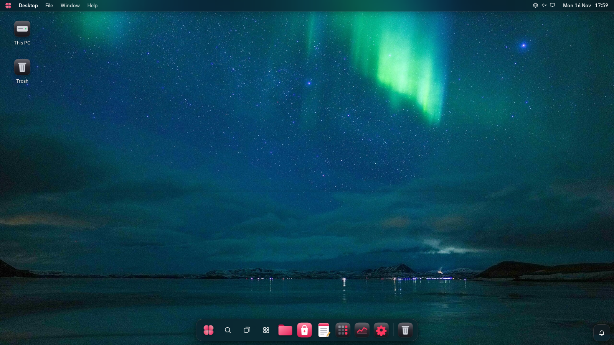

# LuminaOS

LuminaOS is an original desktop operating system built on Debian 13 (trixie) and shipped as a bootable x86-64 ISO. It blends a Windows 11 layout with macOS-style motion and HarmonyOS-soft visuals, all implemented in a custom Python + GTK3 + WebKitGTK shell with its own HTML/CSS/JS app suite.

> **Status:** 1.1 "Aurora" source and release kit. The 1.0 ISO is the last image actually built and boot-tested. The 1.1 source must be rebuilt on Linux with `build.sh` before producing a 1.1 ISO.



## Highlights

- **Custom shell** — top bar, dock with magnification, Start menu, Launchpad, Search, Control Centre, Notification Centre, Task View, lock screen and power overlay.
- **Built-in apps** — Files, Settings, Task Manager, Notepad, Calculator, Snip, Photos, Store, Compatibility, Setup and more.
- **Local API** — 60+ HTTP + Server-Sent Events endpoints on `127.0.0.1:7700`, documented in [`LuminaOS-performance/API.md`](LuminaOS-performance/API.md).
- **Performance preset** — `custom`, `balanced` and `low-power`, with persistence and no-op write suppression.
- **Accessibility** — UI scale, high contrast, strong focus rings, reduced motion, and a global `Ctrl+K` command palette.
- **Installer** — Calamares-based, branded launcher, first-run setup app and GRUB safe-graphics recovery.
- **Files & notifications** — undo/redo, split view, archives, Trash restore, notification actions, snooze, quiet hours and per-app rules.

## Repository layout

| Path | Contents |
|---|---|
| `LuminaOS-performance/` | Full source: `src/` (shell, apps, UI), `system/` (skel, GRUB, installer hooks), `tools/` (tests, benchmarks, icon builders), `virtualbox/`, `release/` kit, `build.sh` |
| `LuminaOS-1.0-amd64.iso` | Bootable hybrid BIOS + UEFI ISO (Git LFS) |
| `LuminaOS-1.0-amd64.iso.sha256` | ISO checksum |
| `LuminaOS-1.1-Release-Kit.zip` | 1.1 release readiness kit (docs, checklists, build helpers) |
| `LuminaOS-Features-1.4-1.5-Patch.zip` | Accessibility, command palette, Files, notifications, compatibility |
| `LuminaOS-Installer-FirstRun-Patch.zip` | Installer and first-run setup |
| `LuminaOS-Performance-Patch-1.1.zip` | Performance preset and optimisations |
| `LuminaOS 1.0 Project Report.pdf` | Full project report |
| `LuminaOS 1.1 Performance Improvement Report.docx` | Performance report |
| `LuminaOS-performance/screenshots/` | Desktop, app and VM screenshots |

## Try it

1. Install VirtualBox.
2. Run `Run LuminaOS in VirtualBox.cmd` (Windows) or use a VM creator from `LuminaOS-performance/virtualbox/`.
3. Boot the ISO. The live session autologins as `lumina`; any password prompt uses `live`.

## Build from source

Building requires a Debian/Ubuntu host with root privileges, roughly 8 GB of free disk space and the packages listed in `LuminaOS-performance/packages.list`.

```bash
cd LuminaOS-performance
sudo bash build.sh
```

The output ISO and checksum are written to `LuminaOS-performance/lumina/`. See [`LuminaOS-performance/REPORT.md`](LuminaOS-performance/REPORT.md), [`TROUBLESHOOTING.md`](LuminaOS-performance/TROUBLESHOOTING.md) and [`CONTRIBUTING.md`](LuminaOS-performance/CONTRIBUTING.md) for details.

## Tests

The Python and JavaScript suites run on the host and do not require a VM:

```bash
cd LuminaOS-performance
python3 tools/test-release.py
python3 tools/test-features.py
python3 tools/test-installer.py
python3 tools/test-performance.py
node tools/test-performance.js
```

## Design and licensing notes

LuminaOS re-creates a similar look and feel to FlowOS using its own code, artwork and branding. No FlowOS, Microsoft, Apple or Huawei code, icons or trademarks are used. Wallpapers are CC-licensed nature photos credited in the project report.

No open-source license file has been added to this repository yet.
